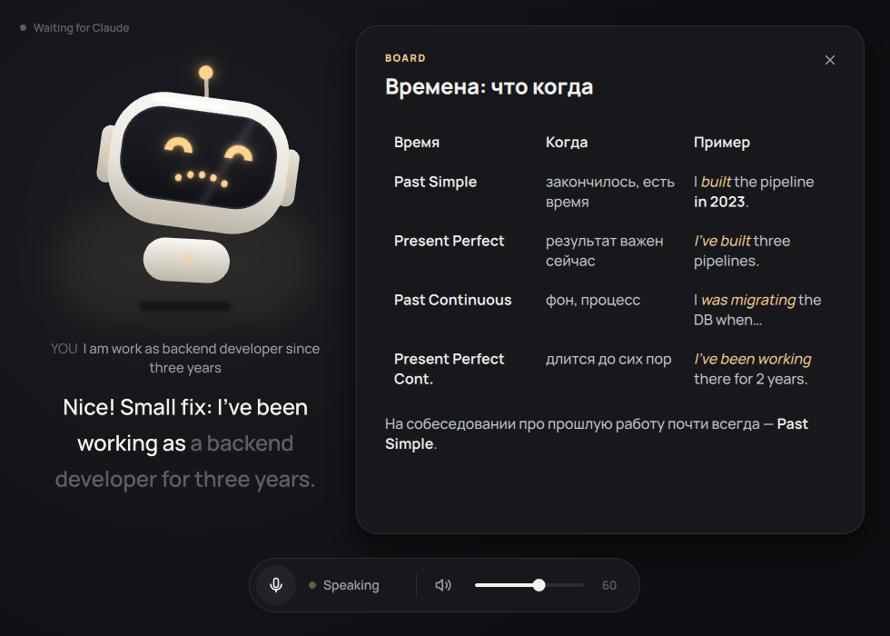

# Parley

Голосовой компаньон для практики английского. На экране Пип, маленький парящий робот. Через него
Claude слышит твой микрофон и отвечает вслух: ведёт пробное собеседование, ловит, где ты
застрял, даёт нужную фразу и возвращает её позже. Объяснения может давать по-русски, с табличкой на доске.

<p align="center">
  
  
</p>

- **Говори** по-английски, по-русски или вперемешку. Под Пипом видно, что он услышал, и что он говорит
  сейчас (уже произнесённое подсвечено).
- **Пип не говорит поверх тебя.** Он ждёт паузу; если ты продолжил мысль, его ответ отменяется, и Claude
  отвечает уже на всю мысль. Перебить тебя он может, только если Claude явно это решил (редко).
- **Ты можешь перебить Пипа.** Он замолкает, а Claude узнаёт, какую часть фразы ты не дослушал.
- **Доска.** Для объяснения (времена, правила, примеры) Пип отходит в сторону и показывает на табличку.
- **Панель внизу:** кнопка микрофона (выключил — Пип тебя не слышит, например когда уходишь в Discord)
  и громкость его голоса. Клавиши: **M** — микрофон, **↑/↓** — громкость, **Esc** — закрыть доску.
  Микрофон также выключается кликом по Пипу, из трея или хоткеем.
- **Голос мужской, эмоциональный и без акцента** (Fish Audio, теги эмоций вроде `[excited]`). Фраза режется
  по языкам: английское говорит голос-носитель английского, русское — носитель русского.
- **Пип показывает состояние:** глаза и огоньки светятся голубым (ждёт), мятным (слушает), сиреневым (думает),
  янтарным (говорит); красные «уши» — микрофон выключен. Форма глаз передаёт эмоцию.
- **Звуки** (смех, кашель, стук, музыка) Пип тоже слышит; на резкие вздрагивает.

## Запуск

```bash
uv run parley                    # окно + MCP-сервер в фоне
uv run parley connect-claude     # один раз: зарегистрировать сервер в Claude Code
```

1. При первом запуске создаётся `~/.config/parley/config.toml`. Впиши `api_key` OpenRouter
   (или задай переменную `OPENROUTER_API_KEY`) и перезапусти приложение.
2. Запусти `claude` и скажи: *«давай практиковать английский с Parley»*. Инструкцию, как слушать и
   как учить, Claude получает сам при подключении (поле MCP `instructions`).
3. Локальные модели (детектор речи, классификатор звуков, запасной голос) скачиваются при первом
   использовании в `~/.local/share/parley/models`.

На NixOS Qt из колеса PySide6 не находит пару системных библиотек; Parley сам подгружает их из
`/nix/store` (`interfaces/gui/nixos.py`). Насовсем: добавь `krb5` и `brotli` в `programs.nix-ld.libraries`.

Закрытие окна, Ctrl+C в терминале или Ctrl+Q завершают программу.

### Хоткей микрофона (Hyprland)

```
bind = SUPER, M, exec, curl -sX POST http://127.0.0.1:8790/ears/toggle
```

## Сколько стоит

| Что | Модель | Цена |
|---|---|---|
| Распознавание | `openai/gpt-4o-mini-transcribe` + подсказка со словарём; при отказе — `whisper-large-v3-turbo` | ≈ $0.11 за час твоей речи; тишина не отправляется |
| Голос | `fish-audio/s2.1-pro-free:free` | бесплатно; при сбое — локальный Piper |
| Звуки, детектор речи | локально (sherpa-onnx) | бесплатно |

Почему не whisper (он в 9 раз дешевле): смешанную речь он переводит целиком на один язык.
«Ну, I worked on data pipelines, короче…» превращается в «Но я работал на дата-пиплайнах…», и Claude видит
не то, что ты сказал. На тестовых записях с русским акцентом и смешанной речью: gpt-4o-mini-transcribe
с подсказкой — 6% ошибок в словах, whisper turbo — 15%, qwen3-asr — 12–17%. Вернуть whisper:
`transcription_model` в конфиге. Подсказка (`transcription_prompt`) — словарь имён и техники,
которые распознавание должно знать; допиши туда свои.

Новые аккаунты OpenRouter ограничены 20 запросами в минуту к модели распознавания; сверх лимита фраза
уйдёт в запасную модель.

**Другой голос.** Любой голос из библиотеки fish.audio (Voice Library): id со страницы голоса →
`[voice] english` или `[voice] russian` в конфиге. Берите голоса носителей: голос, записанный на одном языке,
говорит на другом с акцентом.

**Эхо.** В колонках микрофон слышит самого Пипа. Parley сам измеряет громкость эха в начале каждой реплики
и засчитывает перебивание, только когда ты заметно громче (`hearing.echo_margin`). В наушниках эха нет.

## Как Claude подключается

| Канал | Для чего |
|---|---|
| `http://127.0.0.1:8790/mcp` | MCP: `say`, `listen`, `emote`, `show_board`, `hide_board`, `save_phrase`, `due_phrases`, `review_phrase`, `note_mistake`, `progress`, `status`, `set_ears`, `stop_speaking` |
| `/events` | SSE-поток событий: `heard`, `sound`, `interrupted`, `speech_dropped`, `speech_finished`, `ears_closed`… |
| `/events.ndjson` | то же, по одной JSON-строке; Claude Code подписывается через Monitor и `curl -sN` |
| `listen` (MCP) | long-poll, если подписаться на поток нельзя |
| `/ears/toggle`, `/status` | для хоткеев и скриптов (`uv run parley ears toggle`, `uv run parley status`) |

## Что где менять

| Хочу изменить | Файл |
|---|---|
| Цвета, шрифт, размеры, скорость анимаций | `src/parley/interfaces/gui/qml/Theme.qml` |
| Внешность, движения и эмоции Пипа | `src/parley/interfaces/gui/qml/Pip.qml` |
| Раскладку окна, доску, субтитры, панель | `qml/Main.qml`, `qml/Board.qml`, `qml/Subtitles.qml`, `qml/Dock.qml` |
| Вид таблиц и выделений на доске | `src/parley/interfaces/gui/board_style.py` |
| Как фраза делится между голосами | `src/parley/infrastructure/audio/voices.py` (`language_runs`) |
| Как Claude учит (метод, языки, стиль исправлений) | `src/parley/interfaces/mcp/instructions.md` |
| Когда Пипу можно говорить (пауза, перебивание) | `src/parley/domain/companion.py`, `domain/speech.py`, `[conversation]` в конфиге |
| Интервалы повторения, правила фраз и ошибок | `src/parley/domain/learning.py` |
| Модели, голос, пороги, устройства | `~/.config/parley/config.toml` |
| Распознавание или голос на другой сервис | `src/parley/infrastructure/` + одна строка в `src/parley/bootstrap.py` |
| Новый инструмент для Claude | команда/запрос в `application/`, обёртка в `interfaces/mcp/server.py` |

## Архитектура

Clean Architecture: зависимости направлены только внутрь.

```
domain/           правила без библиотек: Companion, Speech, Phrase, Mistake, Utterance
application/      CQRS: commands.py (меняют состояние) и queries.py (только читают), порты в ports.py
infrastructure/   реализации портов: PipeWire, sherpa-onnx, OpenRouter, SQLite, журнал событий
interfaces/       MCP-сервер (+SSE) для Claude и окно на Qt Quick
bootstrap.py      composition root: единственное место, где выбираются реализации
```

Поток данных: микрофон → `ears.py` (детектор речи, распознавание, звуки, защита от эха) → команды
(`UserStartedTalking`, `UserFinishedTalking`, `NoticeSound`) → агрегаты домена → события в журнал →
Claude (SSE/listen) и окно (`bridge.py`). Ответ: `say` → команда `Say` (ждёт паузу) → `mouth.py`
(синтез по предложениям, воспроизведение, прогресс) → `speech_started`, `interrupted`, `speech_dropped`, `speech_finished`.

## Разработка

```bash
uv run pytest            # домен, приложение, рот — без звука и сети
uv run ruff check src tests scripts
uv run mypy              # домен и приложение
QT_QPA_PLATFORM=offscreen QT_QUICK_BACKEND=rhi QSG_RHI_BACKEND=opengl \
  uv run python scripts/screenshots.py   # снимки окна во всех состояниях → ./screenshots
```
