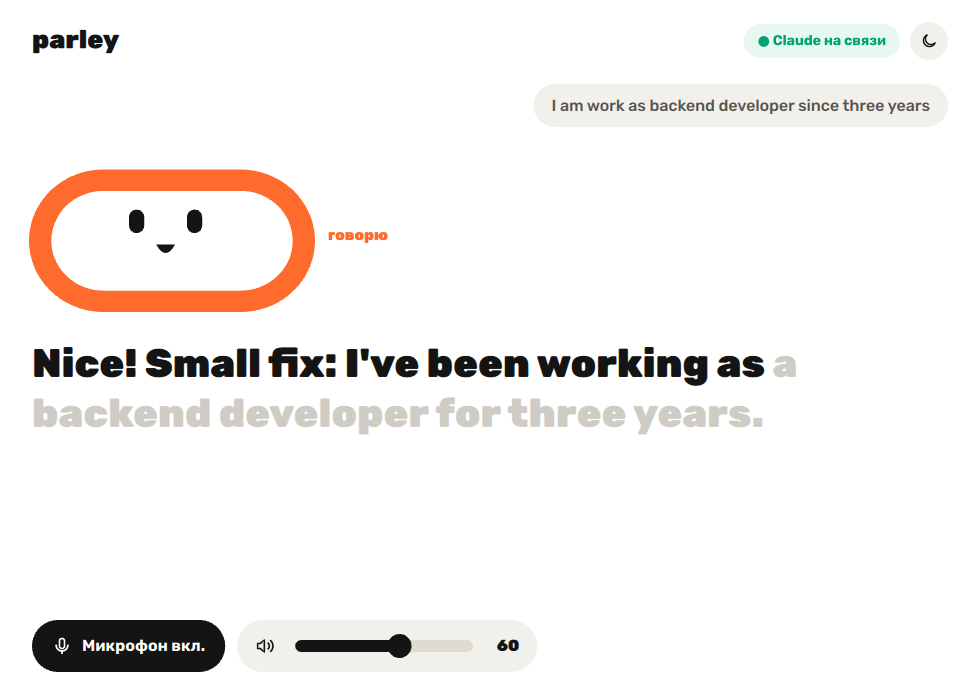
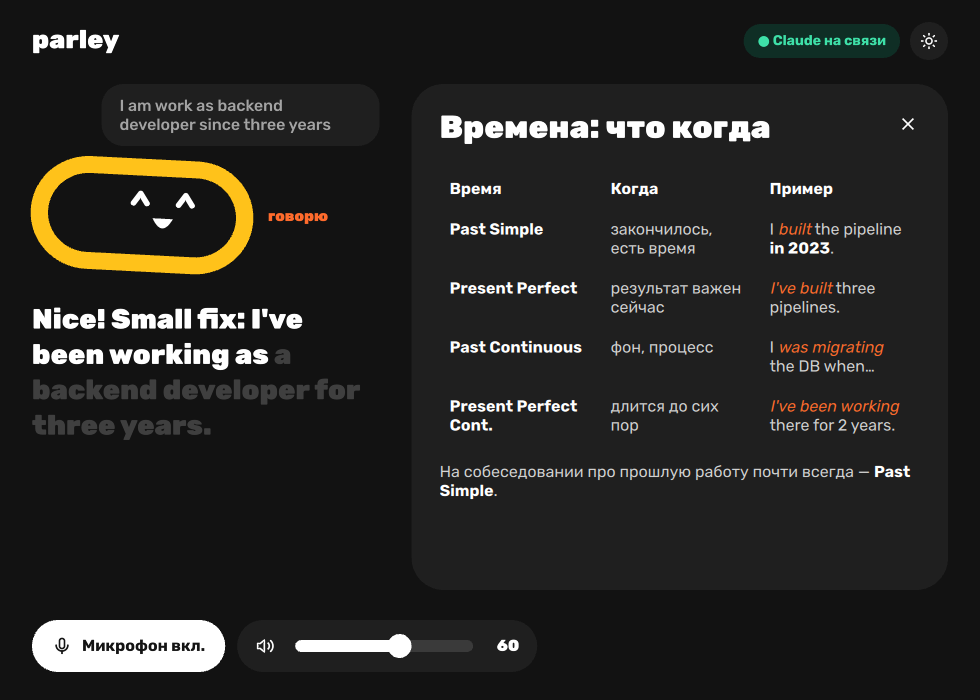

# Parley

Голосовой компаньон для практики английского. На экране Пип — полая капсула с лицом: цвет и выражение меняются вместе с эмоцией и состоянием. Через него
Claude слышит твой микрофон и отвечает вслух: ведёт пробное собеседование, ловит, где ты
застрял, даёт нужную фразу и возвращает её позже. Объяснения может давать по-русски, с табличкой на доске.

<p align="center">
  
  
</p>

- **Говори** по-английски, по-русски или вперемешку. Под Пипом видно, что он услышал, и что он говорит
  сейчас (уже произнесённое подсвечено).
- **Пип не говорит поверх тебя и даёт договорить.** Агент получает мысль целиком: она заканчивается,
  когда ты молчишь дольше 2.5 с (`turn_end_s` в `[conversation]`; не успеваешь договорить — увеличь).
  Пока ты подбираешь слова, Пип слушает, а распознанное уже видно в облачке над ним.
  Перебить тебя он может, только если агент явно это решил (редко).
- **Текст целиком.** Реплика агента и твоя фраза видны полностью и не исчезают, пока не сменятся
  следующими; длинная реплика мельче и прокручивается вслед за голосом.
- **Ты можешь перебить Пипа.** Он замолкает, а Claude узнаёт, какую часть фразы ты не дослушал.
- **Доска.** Для объяснения (времена, правила, примеры) Пип отходит в сторону и показывает на табличку.
- **Панель внизу:** кнопка микрофона (выключил — Пип тебя не слышит, например когда уходишь в Discord)
  и громкость его голоса. Клавиши: **M** — микрофон, **↑/↓** — громкость, **T** — тема, **Esc** — закрыть доску.
  Микрофон также выключается кликом по Пипу, из трея или хоткеем.
- **Голос мужской, эмоциональный и без акцента** (Fish Audio, теги эмоций вроде `[excited]`). Фраза режется
  по языкам: английское говорит голос-носитель английского, русское — носитель русского.
- **Пип показывает состояние цветом и лицом:** серый — ждёт Claude, синий — готов, зелёный — слушает,
  фиолетовый — думает, оранжевый — говорит, жёлтый — радуется, розовый — удивлён; серый со «z» — микрофон выключен.
- **Светлая и тёмная тема** — кнопка в шапке или клавиша **T**; по умолчанию как в системе, выбор запоминается.
- **Звуки** (смех, кашель, стук, музыка) Пип тоже слышит; на резкие вздрагивает.

## Запуск

Работает на **Linux, Windows и macOS** (Apple Silicon и Intel, macOS 14+). Нужен только
[uv](https://docs.astral.sh/uv/getting-started/installation/) — нужный Python он скачает сам.

```bash
git clone https://github.com/toffee-vibe/parley && cd parley
uv run parley                    # окно + MCP-сервер в фоне
uv run parley agents              # проверить, к каким агентам подключён Parley
```

1. При первом запуске создаётся `~/.config/parley/config.toml`. Впиши `api_key` OpenRouter
   (или задай переменную `OPENROUTER_API_KEY`) и перезапусти приложение.
2. В папке проекта запусти агента и скажи: *«давай практиковать английский с Parley»*.
   Подойдёт Claude Code (`claude`), Kimi Code (`kimi`), Codex (`codex`), opencode (`opencode`) или
   Antigravity CLI (`agy`). Инструкцию, как слушать и
   как учить, агент получает сам при подключении (поле MCP `instructions` или инструмент `instructions`).

   Как агент тебя слышит: Claude Code подписывается на поток событий (Monitor); в opencode Parley сам
   присылает услышанное в его сессию (через `opencode api`, сообщением «Parley events…») — агенту не нужно
   ничего ждать; Kimi, Codex и Antigravity опрашивают Parley инструментом `listen`.

   **Parley подключается только в этой папке.** Каждый агент берёт сервер из файла проекта:
   `.mcp.json` (Claude Code спросит разрешение при первом запуске; Kimi Code читает его же),
   `.codex/config.toml` (Codex читает его, когда проект отмечен доверенным), `opencode.json`,
   `.agents/plugins/parley/` (плагин проекта для Antigravity). В других папках агенты о Parley не знают и к нему
   не стучатся. Если раньше регистрировал Parley глобально — `uv run parley agents --clean` уберёт это.
   Порт в этих файлах — 8790; поменял `[server] port` в конфиге — поменяй и в них.
3. Локальные модели (детектор речи, классификатор звуков, запасной голос) скачиваются при первом
   использовании в `~/.local/share/parley/models`.

### Windows и macOS

- **Звук** идёт через PortAudio (библиотека `sounddevice`, ставится сама). На Linux с PipeWire — через PipeWire,
  на Linux без него нужен пакет `libportaudio2`. Выбрать вручную: `PARLEY_AUDIO=portaudio` или `pipewire`.
- **Устройства.** Пусто в `[hearing] input` / `[voice] output` — системные по умолчанию. Другое — впиши часть
  имени устройства, список: `uv run python -m sounddevice`.
- **macOS:** при первом запуске система спросит доступ к микрофону для терминала — разреши
  (Системные настройки → Конфиденциальность → Микрофон).
- **Файлы** лежат там же, где на Linux: `~/.config/parley/config.toml` и `~/.local/share/parley/`
  (на Windows `~` — это `C:\Users\<имя>`).
- **Не работает?** Открой issue и приложи вывод `uv run parley doctor` — там система, звук, устройства и Qt,
  без ключей. Проверка в GitHub Actions собирает Parley на всех трёх системах на каждый коммит.

На NixOS Qt из колеса PySide6 не находит пару системных библиотек; Parley сам подгружает их из
`/nix/store` (`interfaces/gui/nixos.py`). Насовсем: добавь `krb5` и `brotli` в `programs.nix-ld.libraries`.

Закрытие окна, Ctrl+C в терминале или Ctrl+Q завершают программу.

### Хоткей микрофона (Hyprland)

```
bind = SUPER, M, exec, curl -sX POST http://127.0.0.1:8790/ears/toggle
```

## Сколько стоит

| Что | Модель | Цена |
|---|---|---|
| Распознавание | `openai/gpt-4o-mini-transcribe` + подсказка со словарём; при отказе — `whisper-large-v3-turbo` | ≈ $0.11 за час твоей речи; тишина не отправляется |
| Голос | `fish-audio/s2.1-pro-free:free` | бесплатно; при сбое — локальный Piper |
| Звуки, детектор речи | локально (sherpa-onnx) | бесплатно |

**Без облака и бесплатно.** `[transcription] engine = "local"` — речь распознаёт встроенная модель
Parakeet TDT 0.6b v3 прямо на компьютере (~500 МБ скачивается один раз, ~0.3 с на фразу на обычном процессоре).
Без ключа OpenRouter Parley так и работает сам (`engine = "auto"`), а голос тогда — локальный Piper.
С ключом встроенная модель подстраховывает облако, если оно не ответило (нет сети, кончились деньги) —
когда она уже скачана.

| Распознавание | ошибок в словах* | на фразу | цена |
|---|---|---|---|
| облако: gpt-4o-mini-transcribe (по умолчанию с ключом) | 6–8% | ~1 с | ~$0.11/час речи |
| встроенное: Parakeet v3 (`local_model = "parakeet"`) | 14% | ~0.3 с | бесплатно |
| облако: whisper-large-v3-turbo | 15–19% | ~1 с | ~$0.012/час |
| встроенное: Whisper turbo (`local_model = "whisper-turbo"`) | 17% | ~2.5 с | бесплатно |

\* на записях с русским акцентом и смешанной русско-английской речью.

Почему не whisper (он в 9 раз дешевле): смешанную речь он переводит целиком на один язык.
«Ну, I worked on data pipelines, короче…» превращается в «Но я работал на дата-пиплайнах…», и Claude видит
не то, что ты сказал. На тестовых записях с русским акцентом и смешанной речью: gpt-4o-mini-transcribe
с подсказкой — 6% ошибок в словах, whisper turbo — 15%, qwen3-asr — 12–17%. Вернуть whisper:
`transcription_model` в конфиге. Подсказка (`transcription_prompt`) — словарь имён и техники,
которые распознавание должно знать; допиши туда свои.

Новые аккаунты OpenRouter ограничены 20 запросами в минуту к модели распознавания; сверх лимита фраза
уйдёт в запасную модель.

**Другой голос.** Любой голос из библиотеки fish.audio (Voice Library): id со страницы голоса →
`[voice] english` или `[voice] russian` в конфиге. Берите голоса носителей: голос, записанный на одном языке,
говорит на другом с акцентом.

**Эхо.** В колонках микрофон слышит самого Пипа. Parley сам измеряет громкость эха в начале каждой реплики
и засчитывает перебивание, только когда ты заметно громче (`hearing.echo_margin`). В наушниках эха нет.

## Чтобы разговаривать было не неловко

- **Характер.** Пип — коллега-разработчик, а не учитель: говорит просто, со своим мнением и сухим юмором,
  без «Great job!» и без перебора эмоций. Всё это — в начале `interfaces/mcp/instructions.md`.
- **Память.** Claude молча запоминает факты о тебе (работа, проекты, к чему готовишься, незакрытые темы)
  и в начале сессии продолжает с того места, где остановились. Хранится в `parley.db`, таблица `facts`.
- **Слушает молча.** Пока ты говоришь, Пип кивает на твоих паузах — без звуков.

## Если что-то сломалось

Каждый запуск пишет журнал `~/.local/share/parley/logs/parley-…log` (хранятся последние 20): лог, всё, что
было в терминале (включая сообщения Qt, onnxruntime, PortAudio, дочерних процессов), падения потоков,
предупреждения Python и даже падения в C-коде. Для issue:

```bash
uv run parley bugreport   # один файл: система, звук, агенты, журналы двух последних запусков (без ключей)
```

## Технический дневник: что улучшать

Parley записывает, как он работал, в `~/.local/share/parley/diary/ГГГГ-ММ-ДД.jsonl`
(одна JSON-строка на запись, хранится 60 дней, никуда не отправляется):

- каждый запрос распознавания: модель, длина звука, задержка, цена, ошибка;
- каждый запрос облачного голоса;
- выброшенные «выдуманные» фразы, сорвавшаяся речь, перебивания (с громкостью эха);
- события разговора, все предупреждения из логов;
- заметки Claude: инструмент `note_for_developer`, Claude молча отмечает, что мешало (не расслышал, Пип перебил, долго ждал ответа…).

Сводка:

```bash
uv run parley report          # сегодня
uv run parley report -d 7     # за неделю: сколько стоило, задержки, сбои, заметки Claude
```

Учебная статистика (фразы, ошибки, твоя речь) — отдельно, в `parley.db`.

## Как Claude подключается

| Канал | Для чего |
|---|---|
| `http://127.0.0.1:8790/mcp` | MCP: `say`, `listen`, `emote`, `show_board`, `hide_board`, `save_phrase`, `due_phrases`, `review_phrase`, `note_mistake`, `progress`, `recall`, `remember`, `forget`, `status`, `set_ears`, `stop_speaking`, `note_for_developer` |
| `/events` | SSE-поток событий: `heard`, `sound`, `interrupted`, `speech_dropped`, `speech_finished`, `ears_closed`… |
| `/events.ndjson` | то же, по одной JSON-строке; Claude Code подписывается через Monitor и `curl -sN` |
| `listen` (MCP) | long-poll, если подписаться на поток нельзя |
| `/ears/toggle`, `/status` | для хоткеев и скриптов (`uv run parley ears toggle`, `uv run parley status`) |

## Что где менять

| Хочу изменить | Файл |
|---|---|
| Цвета обеих тем, цвета эмоций Пипа, шрифт, размеры, анимации | `src/parley/interfaces/gui/qml/Theme.qml` |
| Форма, лица и движения Пипа | `src/parley/interfaces/gui/qml/Pip.qml` |
| Раскладку окна, доску, реплики, кнопки | `qml/Main.qml`, `qml/Board.qml`, `qml/Subtitles.qml`, `qml/HeardBubble.qml`, `qml/Dock.qml` |
| Вид таблиц и выделений на доске | `src/parley/interfaces/gui/board_style.py` |
| Как фраза делится между голосами | `src/parley/infrastructure/audio/voices.py` (`language_runs`) |
| Характер Пипа, память, как Claude учит (метод, языки, стиль исправлений) | `src/parley/interfaces/mcp/instructions.md` |
| Когда Пипу можно говорить (пауза, перебивание) | `src/parley/domain/companion.py`, `domain/speech.py`, `[conversation]` в конфиге |
| Интервалы повторения, правила фраз и ошибок | `src/parley/domain/learning.py` |
| Модели, голос, пороги, устройства | `~/.config/parley/config.toml` |
| Распознавание или голос на другой сервис | `src/parley/infrastructure/` + одна строка в `src/parley/bootstrap.py` |
| Что пишется в технический дневник и сводку `parley report` | `src/parley/infrastructure/diary.py` |
| Новый инструмент для Claude | команда/запрос в `application/`, обёртка в `interfaces/mcp/server.py` |

## Архитектура

Clean Architecture: зависимости направлены только внутрь.

```
domain/           правила без библиотек: Companion, Speech, Phrase, Mistake, Utterance
application/      CQRS: commands.py (меняют состояние) и queries.py (только читают), порты в ports.py
infrastructure/   реализации портов: PipeWire, sherpa-onnx, OpenRouter, SQLite, журнал событий
interfaces/       MCP-сервер (+SSE) для Claude и окно на Qt Quick
bootstrap.py      composition root: единственное место, где выбираются реализации
```

Поток данных: микрофон → `ears.py` (детектор речи, распознавание, звуки, защита от эха) → команды
(`UserStartedTalking`, `UserFinishedTalking`, `NoticeSound`) → агрегаты домена → события в журнал →
Claude (SSE/listen) и окно (`bridge.py`). Ответ: `say` → команда `Say` (ждёт паузу) → `mouth.py`
(синтез по предложениям, воспроизведение, прогресс) → `speech_started`, `interrupted`, `speech_dropped`, `speech_finished`.

## Разработка

```bash
uv run pytest            # домен, приложение, рот — без звука и сети
uv run ruff check src tests scripts
uv run mypy              # домен и приложение
QT_QPA_PLATFORM=offscreen QT_QUICK_BACKEND=rhi QSG_RHI_BACKEND=opengl \
  uv run python scripts/screenshots.py   # снимки окна во всех состояниях → ./screenshots
```
